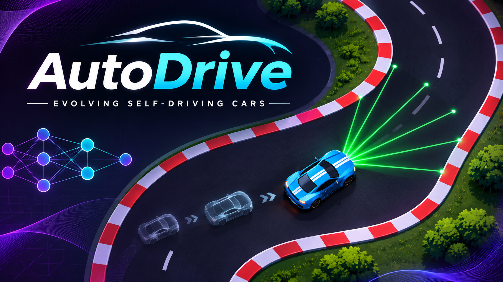

# 🚗 AutoDrive: Evolving Self-Driving Cars Using AI

### Winter in Data Science (WiDS 6.0) | IIT Bombay

## 📌 About the Project

What if a car could teach itself how to drive?

AutoDrive is a six-week, hands-on artificial intelligence project focused on building a virtual self-driving car simulator entirely in Python.

Participants will develop intelligent agents capable of navigating racetracks autonomously using NEAT (NeuroEvolution of Augmenting Topologies), an evolutionary algorithm that optimizes both the structure and weights of neural networks.

Rather than explicitly programming driving instructions, we will allow cars to learn through successive generations of evolution, improving their driving abilities based on fitness and performance.

The project follows a beginner-friendly approach, starting with programming fundamentals and gradually progressing towards a fully functional autonomous driving simulator.

## 🎯 Learning Objectives

By the end of this project, participants will understand:

- Python programming and object-oriented programming.
- Scientific computing using NumPy.
- Data visualization using Matplotlib.
- Game development and simulation using Pygame.
- Vehicle movement and collision detection.
- Virtual radar sensors and ray casting.
- Fundamentals of artificial neural networks.
- Genetic algorithms and evolutionary computation.
- NEAT and neuroevolution.
- AI model evaluation and fitness optimization.

## 🛠️ Technology Stack

| Technology | Purpose |
|------------|---------|
| Python | Core programming language |
| NumPy | Numerical computation |
| Matplotlib | Performance visualization |
| Pygame | Driving simulation and graphical interface |
| NEAT-Python | Neural network evolution |
| Git & GitHub | Version control and submissions |

## 📅 Project Roadmap

### Week 1: Python and Programming Fundamentals

- Python syntax and data structures
- Functions and object-oriented programming
- NumPy fundamentals
- Data visualization using Matplotlib
- Git and GitHub basics
- Development environment setup

**Outcome:** Establish the programming foundations required for the project.

### Week 2: Game Development and Vehicle Simulation

- Introduction to Pygame
- Game loops and rendering
- Keyboard controls
- Vehicle movement and rotation
- Acceleration and braking
- Racetrack design

**Outcome:** Build a manually controlled virtual racing car.

### Week 3: Virtual Sensors and Environment Interaction

- Vectors and trigonometry
- Collision detection
- Ray casting
- Virtual radar sensors
- Distance measurement
- Environment perception

**Outcome:** Develop a sensor-equipped car capable of perceiving its surroundings.

### Week 4: Neural Networks and Evolutionary Algorithms

- Fundamentals of neural networks
- Activation functions
- Genetic algorithms
- Selection, mutation and crossover
- Fitness functions
- Introduction to NEAT

**Outcome:** Understand how neural networks can evolve to make intelligent driving decisions.

### Week 5: Building the Self-Driving Car

- Integrating NEAT with Pygame
- Designing neural network inputs and outputs
- Creating fitness functions
- Training successive generations
- Improving autonomous navigation

**Outcome:** Train an AI-controlled car capable of navigating a racetrack independently.

### Week 6: Optimization and Final Project

- Experimenting with NEAT configurations
- Designing custom racetracks
- Evaluating driving performance
- Visualizing fitness across generations
- Saving and loading trained models
- Final project documentation

**Outcome:** Complete a functional and customized autonomous driving simulator.

## 🏁 Expected Final Product

Each participant will aim to develop a working autonomous driving simulator featuring:

- Custom-designed racetracks
- AI-controlled vehicles
- Real-time virtual radar sensors
- Neural network-based driving decisions
- Evolutionary training across multiple generations
- Collision detection
- Fitness and performance visualization
- Saved and reusable trained models

Participants are encouraged to experiment with additional features and develop their own unique implementations.

## 📚 Weekly Resources

Learning resources will primarily consist of curated video tutorials, supplemented by documentation, reference implementations and practical assignments.

| Week | Topic | Resources |
|------|-------|-----------|
| 1 | Python Fundamentals | [Week 1](./Week-1/) |
| 2 | Pygame and Simulation | Coming Soon |
| 3 | Virtual Sensors | Coming Soon |
| 4 | Neural Networks and NEAT | Coming Soon |
| 5 | Autonomous Driving | Coming Soon |
| 6 | Final Project | Coming Soon |

Resources and assignments will be released progressively throughout the project.

## ✅ Prerequisites

- Basic programming knowledge is desirable.
- Familiarity with elementary mathematics.
- Access to a laptop or desktop computer.
- Curiosity about artificial intelligence.
- Willingness to learn and experiment.

No prior experience in machine learning, neural networks, evolutionary algorithms or game development is required.

## ⏳ Project Details

| Parameter | Details |
|-----------|---------|
| Duration | 6 Weeks |
| Weekly Commitment | 6–8 Hours |
| Difficulty | Beginner to Intermediate |
| Mentorship Mode | Guided Project |
| Programming Language | Python |
| Domains | Neural Architectures & Theoretical Machine Learning |

## 📤 Submission Guidelines

Participants are expected to:

1. Maintain an individual GitHub repository.
2. Complete the weekly learning materials and assignments.
3. Regularly commit their implementation progress.
4. Attend mentor discussions and seek clarification when required.
5. Submit a working final project with appropriate documentation.
6. Prepare a short demonstration video showcasing the final simulator.

The emphasis is on understanding concepts and implementing them, rather than simply reproducing tutorial code.

## 🔗 Reference Resources

- [Python Documentation](https://docs.python.org/3/)
- [NumPy Documentation](https://numpy.org/doc/)
- [Matplotlib Documentation](https://matplotlib.org/stable/)
- [Pygame Documentation](https://www.pygame.org/docs/)
- [NEAT-Python Documentation](https://neat-python.readthedocs.io/)
- [3Blue1Brown – Neural Networks](https://www.3blue1brown.com/topics/neural-networks)
- [NeuralNine – AI Car Simulation](https://github.com/NeuralNine/ai-car-simulation)
- [DriveAI – Self-Driving Car Tutorial](https://github.com/MaxRohowsky/DriveAI)

## 👨‍💻 Mentor

**Kushagra**  
Indian Institute of Technology Bombay  
Developer, DevCom IIT Bombay

[GitHub](https://github.com/kuusshagraa)

---

*Learn. Build. Evolve. Drive.*

**AutoDrive | WiDS 6.0 | The Analytics Club, IIT Bombay**